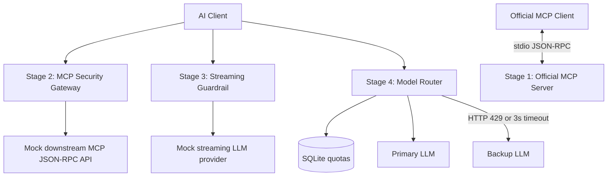

# Assessment implementation notes

## Architecture

## Stage 1

The official SDK's low-level handler APIs allow explicit JSON-RPC `INVALID_PARAMS (-32602)` failures for Pydantic validation errors. Domain errors (missing customers) use MCP tool-error results with `is_error=True`, distinct from protocol errors. Structured content is provided for successful tool calls. All logging uses stderr; the SDK owns the stdio wire.

## Stage 2

Authorization is checked **before** sending any downstream request. Mixed batches are filtered so unauthorized admin requests are not even visible to the downstream mock. Opaque signed bearer claims are verified using constant-time MAC comparisons. The fixed downstream URL is configured by the operator, not chosen by the request, reducing SSRF exposure. The gateway permits tool listing with valid bearer credentials and forwards safe methods.

For a production Streamable HTTP MCP gateway, support protocol negotiation, session management, SSE response bodies, durable request context, consistent batch restrictions, and downstream auth delegation. Those are outside the narrow JSON-RPC exercise.

## Stage 3

The gateway's pipeline is `provider wire bytes -> incremental UTF-8 decoder -> SSE frame parser -> content delta -> bounded token guardrail -> sanitized SSE delta -> client`. Split source bytes, split SSE events, and split PII matches are covered by tests. The maximum pending raw candidate is bounded and overlong runs are replaced with a single `[REDACTED]` placeholder. Done events are emitted only after flushing the final candidate.

Regular expressions are a reasonable minimal assessment guardrail, but a production PII service should consider locale rules, non-ASCII addresses, card issuer prefixes, metadata fields other than `delta.content`, logging redaction, tool responses, prompt injection, policy actions, and performance metrics for TTFT/throughput.

## Stage 4

SQLite contains `(reservation_id, tenant, reserved_tokens, recorded_at)` records. `BEGIN IMMEDIATE` makes the read-modify-write quota check atomic under concurrent tasks and across processes. Each reservation covers anticipated prompt cost plus maximum possible output cost; a later provider-reported usage can reduce the reservation. The window is 60 seconds, inclusive of only events strictly after the cutoff. Network exception strings and provider JSON bodies never appear in public failures.

The mock provider's `force_timeout` sleeps five seconds, allowing the real HTTP client timeout to trigger after three. Unit tests also inject an explicit `ReadTimeout` to avoid slowing the suite. The router does not duplicate requests to the backup on an ordinary HTTP 500, preventing arbitrary retries and potential duplicate side effects.

## Production hardening opportunities

- Use OAuth/OIDC identity provider with trusted key rotation and audience-scoped claims.
- Require HTTPS/mTLS between gateways and providers and apply request-size limits, allowlisting, and structured audit logs.
- Use exact model tokenizers and provider usage accounting instead of the deliberately conservative byte-based approximation.
- Add distributed rate limiting if instances span regions; SQLite is the required on-disk store for the exercise.
- Instrument TTFT, total streaming latency, fallback counts, per-tenant rejections, and errors without logging sensitive payloads.
- Add per-provider circuit breakers, retry budgets, rate-limit backoff, and idempotency protection for side-effectful endpoints.
- Exercise the official MCP SDK's stdio isolation in an environment with the `mcp` v2 dependency installed.
